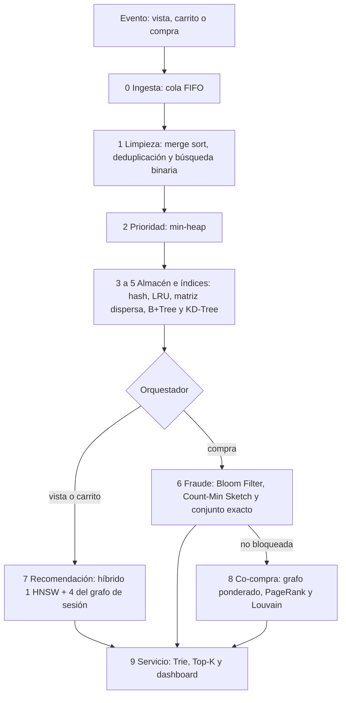

# Motor inteligente de comercio electrónico (REES46)

Pipeline de la opción B del curso, sobre eventos reales de la tienda multi-categoría de REES46. El programa que se ejecuta es el notebook `Proyecto_EDA_Motor_Ecommerce_REES46_v2.ipynb`. La v1 (`Proyecto_EDA_Motor_Ecommerce_REES46.ipynb`) queda como referencia y no forma parte de este flujo.

## Qué hace

Un evento de vista, carrito o compra entra por un núcleo común y después sigue solo la rama que le corresponde. El 60 % inicial del lote entrena el almacén, el índice de recomendación, los filtros de fraude y el grafo. El 40 % restante es el stream vivo: entra por una cola FIFO y sale por un min-heap.



Prioridades del heap, de mayor a menor urgencia: fraude, express, estándar, programada, carrito y vista. Una compra solo se bloquea si un conjunto exacto confirma el dispositivo, el medio de pago o la etiqueta de fraude. Una señal del Bloom Filter o del Count-Min Sketch, sin esa confirmación, queda en revisión. Una compra bloqueada no entra al grafo de co-compra.

El dashboard, al final del notebook, tiene seis pestañas: buscar por ID o por texto, rango de precios, cinco recomendaciones, simular un evento, panel de alertas y grafo. Después vienen la evaluación temporal de la recomendación (corte 60/10/30) y los benchmarks.

REES46 trae vistas, carritos y compras con marca, categoría, precio y sesión. El notebook completa, con una huella reproducible (semilla 42), el dispositivo, el medio de pago, el tipo de entrega y la etiqueta de fraude. Esos campos no vienen en el CSV.

## Cómo se ejecuta

La corrida principal es en Google Colab. El mismo notebook también corre en local.

En la primera celda de código:

| Parámetro | Valor por defecto | Efecto |
|---|---|---|
| `RUN_MODE` | `"quick"` | Lee 100.000 eventos y mide hasta 100K |
| `RUN_MODE` | `"full"` | Lee hasta `MAX_EVENTS` (10.000.000) y mide 1K, 10K, 100K, 1M y 10M |
| `DATASET_FILE` | `2019-Oct.csv` | Único mes que se abre. No se procesan los siete meses |
| `SEED` | `42` | Semilla de la huella, NumPy y las comunidades |

`quick` es el modo de la demo. `full` es la escala del curso y tarda mucho más, sobre todo en el merge sort y en los benchmarks de Python puro.

### Google Colab

1. Abre `Proyecto_EDA_Motor_Ecommerce_REES46_v2.ipynb` en [Google Colab](https://colab.research.google.com/) (Archivo, Subir notebook, o desde Drive).
2. Deja `RUN_MODE = "quick"` en la primera celda, salvo que quieras la escala de 10 millones.
3. Entorno de ejecución, Ejecutar todas.
4. Baja hasta el dashboard cuando termine la celda de ejecución.

Esa celda hace dos cosas antes de recorrer el pipeline. Si falta `hnswlib`, lo instala; si la instalación falla, el índice vectorial usa KNN exacto y lo informa. Después localiza `2019-Oct.csv` con `kagglehub` en el dataset público `mkechinov/ecommerce-behavior-data-from-multi-category-store`. La descarga es el archivo comprimido completo, unos 4,3 GB. El modo `quick` solo lee las primeras 100.000 filas de octubre.

Colab ya trae NumPy, pandas, matplotlib e ipywidgets. El notebook activa el administrador de widgets de Colab para que el dashboard se vea. La sesión necesita espacio para esos 4,3 GB. Si `kagglehub` no puede bajar el dataset, sube `2019-Oct.csv` al directorio de trabajo de la sesión: el notebook lo busca ahí cuando la descarga falla.

### Ejecución local

Hace falta Python 3.9 o superior, Jupyter y el CSV de octubre, o una cuenta de Kaggle para que `kagglehub` lo descargue.

Desde `Trabajo_Grupal_Octubre_29`:

```bash
python3 -m venv .venv
source .venv/bin/activate
python -m pip install --upgrade pip
python -m pip install numpy pandas matplotlib networkx hnswlib ipywidgets kagglehub notebook
```

El dataset se resuelve de una de estas dos formas:

1. Deja `2019-Oct.csv` en esta misma carpeta, que es el directorio desde el que se abre Jupyter. El notebook lo encuentra sin llamar a Kaggle.
2. Configura la API de Kaggle para que `kagglehub` descargue el dataset. En [kaggle.com/settings](https://www.kaggle.com/settings) crea un token y guarda el archivo como `~/.kaggle/kaggle.json`, con permisos de solo lectura para tu usuario (`chmod 600 ~/.kaggle/kaggle.json`). No copies el token dentro del notebook ni del repositorio. La descarga vuelve a ser el archivo completo, unos 4,3 GB, aunque `RUN_MODE` sea `quick`.

Arranca el notebook y ejecuta todas las celdas en orden:

```bash
jupyter notebook Proyecto_EDA_Motor_Ecommerce_REES46_v2.ipynb
```

El dashboard usa ipywidgets. En JupyterLab basta con tener el paquete instalado. Si los controles no aparecen, reinicia el kernel después de instalar `ipywidgets`. Sin ese paquete el pipeline igual termina: la celda del dashboard avisa y el resto de salidas (traza, tablas y benchmarks) sigue en el notebook.

Si `hnswlib` no compila en tu máquina, la celda de ejecución lo intenta instalar y, si no puede, sigue con KNN exacto. Sin NetworkX el grafo de co-compra queda vacío y la pestaña del grafo lo indica.
