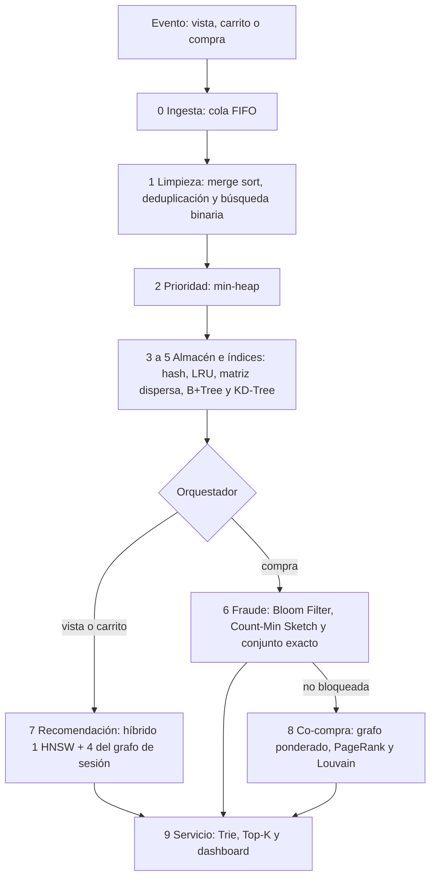

# Motor inteligente de comercio electrónico (REES46)

Trabajo grupal del curso. Toma eventos reales de una tienda multi-categoría (vistas, carritos y compras de REES46) y los procesa con estructuras de datos: primero lo urgente, después búsqueda, recomendación, fraude y productos que se compran juntos.

El programa que se ejecuta es un solo notebook. El resto del repositorio explica el problema, justifica las estructuras elegidas y muestra el recorrido del pipeline.

## Mapa del repositorio

```text
Trabajo_Grupal_Octubre_29/
├── README.md                                         este archivo
├── propuesta_comercio_electronico.md                 problema, dataset y límites de los datos
├── Proyecto_EDA_Motor_Ecommerce_REES46_v2.ipynb      pipeline que se corre (versión vigente)
├── Proyecto_EDA_Motor_Ecommerce_REES46.ipynb         versión anterior, solo de referencia
├── docs/
│   └── como-funciona-el-pipeline.html                explicación visual del pipeline
└── pruebas_algoritmos/
    ├── README.md                                     cómo correr las comparativas
    ├── 00_todas_las_comparativas.ipynb               las cinco evidencias en una corrida
    ├── 01_filtrado_probabilistico.ipynb              Bloom y Count-Min frente al estado exacto
    ├── 02_similitud_conjuntos.ipynb                  MinHash+LSH frente a SimHash y Jaccard
    ├── 03_vecinos_aproximados.ipynb                  HNSW frente a IVF y KNN exacto
    ├── 04_grafo.ipynb                                PageRank y Louvain frente a grado y Label Propagation
    ├── 05_estructuras_base.ipynb                     hash y KD-Tree frente a búsquedas exactas
    ├── resultados/                                   tablas CSV que genera la corrida
    ├── figuras/                                      gráficas que genera la corrida
    └── test/                                         módulos locales; los notebooks no los importan
```

`resultados/`, `figuras/` y `test/` no van al repositorio. Cada notebook vuelve a crear las tablas y las figuras al ejecutarse. El CSV del dataset (`2019-Oct.csv`, unos 4,3 GB comprimido en la descarga completa) tampoco está en el repo: se coloca en esta carpeta o lo baja `kagglehub`.

## Dónde mirar según lo que se quiera

| Si se quiere… | Abrir |
|---|---|
| Entender el problema y el dataset, antes del diseño | `propuesta_comercio_electronico.md` |
| Ver el sistema funcionando (dashboard, evaluación y benchmarks) | `Proyecto_EDA_Motor_Ecommerce_REES46_v2.ipynb` |
| Seguir el recorrido de un evento, etapa por etapa | `docs/como-funciona-el-pipeline.html` (se abre en el navegador) |
| Ver por qué se eligió cada estructura | `pruebas_algoritmos/` y su `README.md` |
| Consultar la primera versión del notebook | `Proyecto_EDA_Motor_Ecommerce_REES46.ipynb` (no forma parte del flujo) |

La propuesta fija el escenario y qué trae (y qué no trae) el CSV. El notebook v2 implementa el motor. Las comparativas miden las alternativas de cada etapa y respaldan lo que quedó en ese notebook. La página de `docs/` cuenta el mismo recorrido sin tener que leer el código.

## Qué hace el pipeline

Un evento de vista, carrito o compra entra por un núcleo común y después sigue solo la rama que le corresponde. El 60 % inicial del lote entrena el almacén, el índice de recomendación, los filtros de fraude y el grafo. El 40 % restante es el stream vivo: entra por una cola FIFO y sale por un min-heap.



El detalle de prioridades, de cuándo se bloquea una compra y de las pestañas del dashboard está en la página de `docs/` y en el propio notebook.

REES46 trae vistas, carritos y compras con marca, categoría, precio y sesión. El notebook completa, con semilla 42, el dispositivo, el medio de pago, el tipo de entrega y la etiqueta de fraude. Esos campos no vienen en el CSV.

## Cómo se ejecuta

La corrida principal es el notebook v2, en Google Colab o en local. En la primera celda de código:

| Parámetro | Valor por defecto | Efecto |
|---|---|---|
| `RUN_MODE` | `"quick"` | Lee 100.000 eventos y mide hasta 100K. Es el modo de la demo |
| `RUN_MODE` | `"full"` | Lee hasta `MAX_EVENTS` (10.000.000) y mide 1K, 10K, 100K, 1M y 10M |
| `DATASET_FILE` | `2019-Oct.csv` | Único mes que se abre. No se procesan los siete meses |
| `SEED` | `42` | Semilla de la huella, NumPy y las comunidades |

### Google Colab

1. Abre `Proyecto_EDA_Motor_Ecommerce_REES46_v2.ipynb` en [Google Colab](https://colab.research.google.com/).
2. Deja `RUN_MODE = "quick"`, salvo que quieras la escala de 10 millones.
3. Entorno de ejecución, Ejecutar todas.
4. Baja hasta el dashboard cuando termine la celda de ejecución.

Si falta `hnswlib`, esa celda lo instala; si la instalación falla, el índice vectorial usa KNN exacto. Después localiza `2019-Oct.csv` con `kagglehub` en el dataset público `mkechinov/ecommerce-behavior-data-from-multi-category-store`. La descarga es el archivo comprimido completo. El modo `quick` solo lee las primeras 100.000 filas de octubre. Si `kagglehub` no puede bajar el dataset, sube `2019-Oct.csv` al directorio de trabajo de la sesión.

### Ejecución local

Hace falta Python 3.9 o superior y Jupyter. Desde esta carpeta:

```bash
python3 -m venv .venv
source .venv/bin/activate
python -m pip install --upgrade pip
python -m pip install numpy pandas matplotlib networkx hnswlib ipywidgets kagglehub notebook
jupyter notebook Proyecto_EDA_Motor_Ecommerce_REES46_v2.ipynb
```

El dataset se resuelve de una de estas dos formas:

1. Deja `2019-Oct.csv` en esta misma carpeta. El notebook lo encuentra sin llamar a Kaggle.
2. Configura la API de Kaggle para que `kagglehub` lo descargue. En [kaggle.com/settings](https://www.kaggle.com/settings) crea un token y guárdalo como `~/.kaggle/kaggle.json`, con permisos de solo lectura para tu usuario (`chmod 600 ~/.kaggle/kaggle.json`). No copies el token dentro del notebook ni del repositorio.

Las comparativas se corren aparte. El modo, la semilla y qué notebook sostiene cada decisión están en `pruebas_algoritmos/README.md`.
